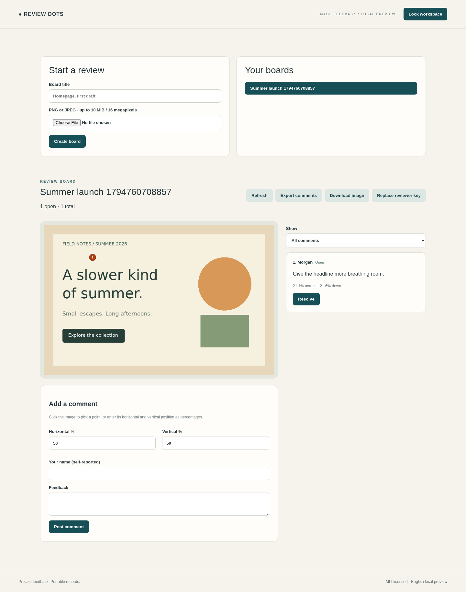

# Review Dots

### Point to what matters.

**Open-source image feedback. A focused MarkUp.io alternative for pinned comments, resolution, and portable review records.**



**Six-language local preview · MIT licensed · Python + SQLite**

## One image. A clear review trail.

Upload a PNG or JPEG. A reviewer places a numbered comment on the exact spot that needs attention. The owner resolves or reopens the comment. Export the image and JSON review history when the work is done.

| Reviewers | Owners | Your records |
| :--- | :--- | :--- |
| Open a board with its ID and access key | Upload an immutable review image | SQLite stores images and comments |
| Place pins by clicking or entering coordinates | Resolve and reopen comments | Export JSON with resolution history |
| Read and filter comments | Replace reviewer keys to revoke access | Download the sanitized review image |

Reviewer names are self-reported, not verified identities. Everyone with a board key can read its image, comments and export, and add comments. Only the owner can resolve comments, create boards, list boards or replace keys.

## Run locally

Requires Python 3.10+.

```sh
python3 -m venv .venv
. .venv/bin/activate
pip install -r requirements.txt
export REVIEW_OWNER_KEY="$(python3 -c 'import secrets; print(secrets.token_urlsafe(32))')"
python server.py
```

Open **http://127.0.0.1:8092**, choose **Owner**, and enter your owner key. Create a board to receive its reviewer ID and key. In another browser session, choose **Reviewer** and enter those details.

The server binds to localhost. This preview works on the machine running it; it is **not a publicly hosted collaboration service**. A persistent WSGI/Compose setup is included; public HTTPS acceptance and native-speaker review remain pending. Do not expose Flask's development server to the internet.

## Choose your language

English · Deutsch · Español · 日本語 · 简体中文 · 繁體中文. The header picker follows supported browser preferences and remembers your choice when storage is available. Switching languages preserves the selected upload, comment drafts, and pin coordinates. Image pixels, board titles, names and comment bodies are never translated. No external translation service is contacted. Native-speaker review is pending; unexpected framework/network errors may fall back to English.

## Persistent setup

```sh
python3 scripts/setup.py
docker compose up -d --build
```

The service uses Waitress, a non-root container, and a persistent SQLite volume. It stays on localhost. See the [deployment and backup guide](docs/DEPLOYMENT.md) for exact storage, recovery, and HTTPS boundaries.

## Deliberately focused

MarkUp.io supports broader digital-content review. Review Dots currently handles **single PNG/JPEG images only**. No live website annotation, PDF/video review, replies, email notifications, accounts, image replacement or full feature parity is claimed. Upload a new board for a changed design so existing pins never silently move to a different image.

Images are limited to 10 MiB and 16 megapixels, decoded, oriented, and re-encoded as PNG without source metadata. Animated images and SVG are rejected. The normalized PNG must also fit within 10 MiB. Each board supports up to 1,000 comments. There is no installation-wide storage quota yet.

## Test the workflow

```sh
python -m unittest discover -s tests -v
```

Sixteen tests cover image sanitization, invalid input, coordinate limits, stale/cross-board resolution, token rotation, HTTP permissions, export, persistence and private non-overwriting backups. `scripts/browser.cjs` covers the actual Chromium owner/reviewer flow, exports, revocation and mobile overflow. Install Playwright in your test environment and pass `REVIEW_OWNER_KEY` and optionally `REVIEW_URL`/`CHROMIUM`. `scripts/locales.cjs` additionally tests all six languages, browser preference fallback, blocked storage, draft/upload preservation, unchanged canvas, and translated access errors. Run against a disposable test database; it creates synthetic review boards using `tests/fixture.png`.

The screenshot above comes from that running workflow, not a proposed UI. No public release or hosted demo exists yet.

[Scope and distribution plan](docs/SCOPE.md) · [Launch handoff](HANDOFF.md) · [MIT license](LICENSE)
